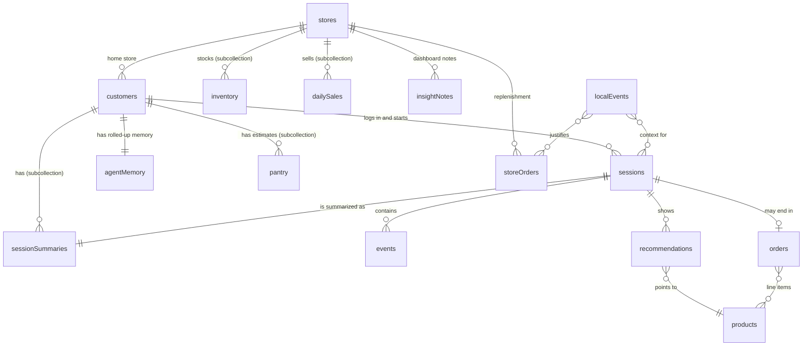

# Spark Agent database map (Cloud Firestore)

Project: `capgeminidemo2` · Database: `(default)` · Location: `nam5`

The website does not read or write Firestore yet. Everything here is seeded by
`database/seed.mjs` so the data model can be reviewed in the Firebase console.

## How the pieces relate

## Collections

### `customers/{customerId}`
Who the shopper is and how the agent should treat them.

| Field | Type | Example | Why it matters |
|---|---|---|---|
| `name`, `email` | string | Doug Martinez | Identity (demo emails only) |
| `household` | map | `{ size: 4, children: 2, childAges: [7, 11] }` | Quantity and pantry math |
| `homeStoreId` | string | `4127` | Inventory, pickup, local events |
| `zip` | string | `29209` | Matches local weather and news alerts |
| `membership` | map | `{ tier: "Walmart+", since: 2019-03-14 }` | Free pickup, delivery eligibility |
| `createdAt` | timestamp | | Account age |
| `lastLoginAt` | timestamp | | Recency |
| `loginCount90d` | number | 23 | Engagement |
| `preferredChannel` | string | `pickup` | Default fulfillment |
| `usualShoppingWindow` | map | `{ days: [1..7], dayOfWeek: "Tue", hours: "16-18" }` | Cadence model |
| `priceSensitivity` | string | `medium` | How much a Rollback moves rank |
| `preferenceWeights` | map<string, number> | `{ dairy_eggs: 0.81 }` | What ranks first on the shop page |
| `spend90d`, `orders90d`, `avgBasket` | number | | Value and frequency |
| `consent` | map | `{ personalization: true, localEvents: true, marketingEmail: false }` | Required before any signal is used |

#### `customers/{customerId}/sessionSummaries/{sessionId}` — past session storage
One agent-written summary per finished session. This is what a future agent reads
instead of replaying thousands of raw events.

| Field | Type | Notes |
|---|---|---|
| `sessionId`, `customerId` | string | Links back to the raw session |
| `startedAt`, `endedAt` | timestamp | |
| `durationSec` | number | |
| `channel`, `device` | string | `app` / `web`, `iPhone` / `desktop` |
| `outcome` | string | `purchased`, `abandoned_cart`, `browse_only` |
| `headline` | string | One line, for lists |
| `summary` | string | A paragraph in plain language |
| `intents` | array<string> | `storm_prep`, `weekly_grocery`, `price_check` |
| `productsViewed` | array<map> | `{ productId, name, dwellSec }` |
| `productsAdded`, `productsAbandoned` | array<string> | Abandoned = added or long-viewed but not bought |
| `orderId`, `spend` | string, number | When the session ended in a purchase |
| `context` | map | Local events active during the session |
| `signalsDerived` | array<map> | `{ type, detail, weight, before, after }` |
| `followUps` | array<string> | Instructions for the next session's agent |
| `generatedBy`, `generatedAt` | string, timestamp | Model version and when it was written |

#### `customers/{customerId}/agentMemory/current`
A rolled-up memory across all summaries, rewritten after each session.
Fields: `summary`, `keyFacts[]`, `openThreads[]`, `lastSessionId`, `sessionsSummarized`, `updatedAt`.

#### `customers/{customerId}/pantry/{productId}`
Fields: `productId`, `lastPurchasedAt`, `avgIntervalDays`, `estimatedRunOutAt`, `confidence`.

### `sessions/{sessionId}`
One visit, from login to exit.

| Field | Type | Notes |
|---|---|---|
| `customerId`, `storeId` | string | |
| `loginAt` | timestamp | Login time |
| `authMethod` | string | `passkey`, `password`, `remembered` |
| `endedAt`, `durationSec` | timestamp, number | |
| `channel`, `device`, `appVersion` | string | |
| `entryPoint` | string | `push_notification`, `direct`, `email`, `search_engine` |
| `counts` | map | `{ productViews, searches, cartAdds, recsShown, recsAccepted }` |
| `totalDwellSec` | number | Total time spent looking at products |
| `outcome` | string | Same values as in the summary |
| `orderId` | string \| null | |
| `localEventIds` | array<string> | Events active during the session |

### `events/{eventId}`
The raw clickstream. Everything else can be rebuilt from it.

| Field | Type | Notes |
|---|---|---|
| `customerId`, `sessionId` | string | |
| `type` | string | `login`, `page_view`, `search`, `product_view`, `recommendation_shown`, `recommendation_click`, `add_to_cart`, `remove_from_cart`, `checkout`, `session_end` |
| `at` | timestamp | |
| `productId` | string \| null | |
| `dwellMs` | number \| null | View time on a product |
| `source` | string | `home`, `search`, `for_you`, `cart_bundle` |
| `position` | number \| null | Where it appeared on the page |
| `query` | string \| null | For searches |
| `detail` | map | Anything event-specific (`nutritionOpened`, `qty`) |

### `orders/{orderId}`
| Field | Type | Notes |
|---|---|---|
| `customerId`, `sessionId`, `storeId` | string | |
| `placedAt` | timestamp | Date purchased |
| `fulfillment` | map | `{ type: "pickup", window: "16:00-17:00", date }` |
| `items` | array<map> | `{ productId, name, qty, unitPrice, wasPrice, recommended, recommendationId }` |
| `subtotal`, `savings`, `tax`, `total` | number | |
| `itemCount` | number | |
| `status` | string | `picked_up`, `delivered`, `completed` |

### `recommendations/{recommendationId}`
Every time the agent shows something, and what happened next. This collection feeds the attach-rate charts.

Fields: `customerId`, `sessionId`, `productId`, `surface` (`for_you`, `cart_bundle`), `rank`, `reason`, `signalsUsed[]`, `shownAt`, `clickedAt`, `addedAt`, `outcome` (`added`, `clicked`, `ignored`).

### `products/{productId}`
Fields: `name`, `brand`, `category`, `aisle`, `price`, `wasPrice`, `unitPrice`, `badge`, `image`, `caseSize`, `imageSource`.

### `stores/{storeId}`
Fields: `name`, `type`, `address`, `city`, `state`, `zip`, `county`, `distributionCenter`.

- `stores/{storeId}/inventory/{productId}`: `onHand`, `dailyRate`, `daysOfSupply`, `updatedAt`.
- `stores/{storeId}/dailySales/{yyyy-mm-dd_productId}`: `date`, `productId`, `units`, `revenue`, `baselineUnits`.

### `localEvents/{eventId}`
News, weather, and area-wide social trends. No personal social accounts are stored.

Fields: `type` (`news_alert`, `weather_forecast`, `social_trend`, `school_closure`), `source`, `headline`, `issuedAt`, `validFrom`, `validTo`, `zips[]`, `county`, `severity`, `affectedProductIds[]`, `series[]` (social volume over time), `topTerms` (share of posts by term).

### `storeOrders/{poId}`
Replenishment orders drafted by the agent for a manager to approve.

Fields: `storeId`, `status` (`draft`, `approved`, `dismissed`), `createdBy`, `createdAt`, `truck`, `reason`, `localEventIds[]`, `lines[]` (`productId`, `onHand`, `normal72h`, `forecast72h`, `qty`, `caseSize`, `cases`), `totalCases`, `approvedBy`, `approvedAt`.

### `insightNotes/{noteId}`
The agent notes shown under the dashboard charts. Fields: `storeId`, `chart`, `text`, `createdAt`, `localEventIds[]`.

## Questions this model answers

- **Login time:** `sessions.loginAt`, `customers.lastLoginAt`, and `events` with `type == "login"`.
- **Date purchased:** `orders.placedAt` and `customers/{id}/pantry.lastPurchasedAt`.
- **View time:** `events.dwellMs` for each product view, rolled up into `sessions.totalDwellSec` and `sessionSummaries.productsViewed`.
- **Why something was recommended:** `recommendations.reason` and `signalsUsed`.
- **Did the recommendation work:** `recommendations.outcome` joined to `orders.items.recommendationId`.
- **What the agent should remember next time:** `sessionSummaries.followUps` and `agentMemory/current.openThreads`.
