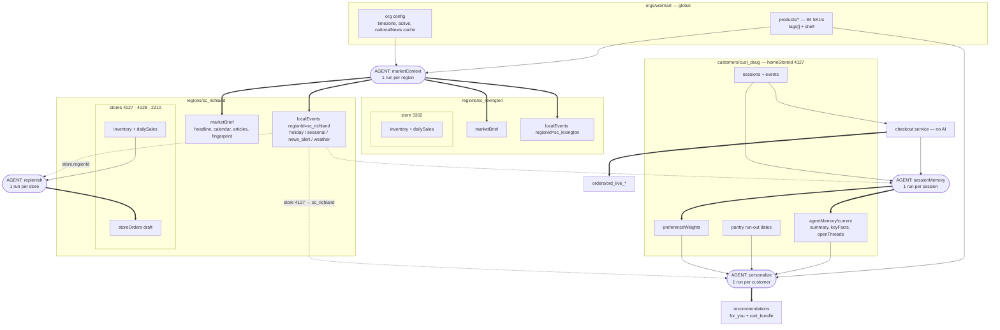
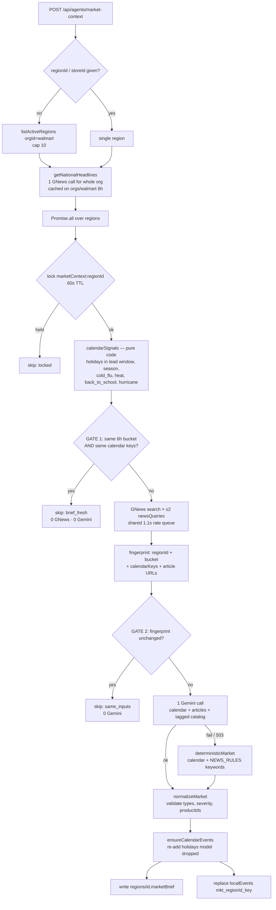
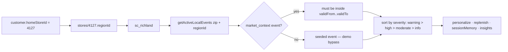
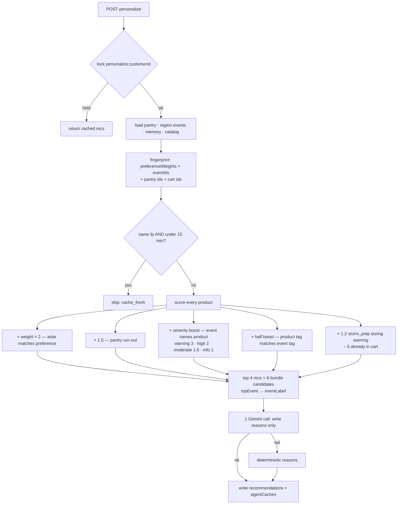
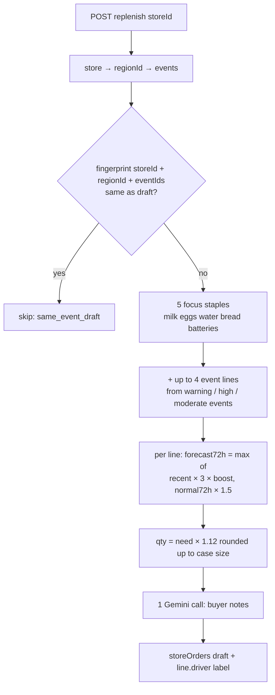
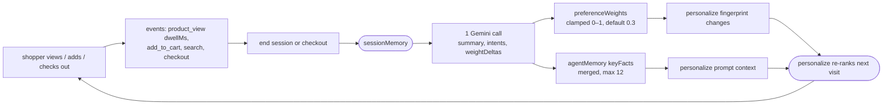

# Spark Agent — Agent Hierarchy

Companion to [AGENT_REPORT.md](AGENT_REPORT.md). Diagrams show where each agent lives, what it reads/writes, and the skip gates that keep it cheap.

---

## 1. Full system: org → region → store → customer

**Legend:** `==>` writes · `-->` reads · `-.->` region-resolved read · rounded boxes = agents (one Gemini call each, max).

---

## 2. Who runs where

| Layer | Agent | Unit of work | Trigger | Gemini calls |
|---|---|---|---|---|
| Org | — | fan-out only | `POST /api/agents/market-context` | 0 |
| Region | **marketContext** | 1 per active region | org fan-out or `{regionId}` | ≤1 per region |
| Store | **replenish** | 1 per store | `POST /api/agents/replenish` | ≤1 per store |
| Customer | **personalize** | 1 per shopper | `POST /api/agents/personalize` | ≤1 per shopper |
| Session | **sessionMemory** | 1 per session | end session / checkout | ≤1 per session |

---

## 3. marketContext — per-region job with two skip gates

**Severity rule (calendar):** ≤3 days → `high` · ≤10 days or major food holiday → `moderate` · else `info`.
Major food holidays: Thanksgiving, Christmas, Easter, July 4, Super Bowl.

**Product mapping:** event tags → `productsForTags`: products whose *first* tag is the occasion outrank ones that merely carry it; ties → higher price (anchor item: turkey, ham, wings).

---

## 4. Region resolution (readers)

---

## 5. personalize — scoring then one Gemini call

---

## 6. replenish — store draft PO

---

## 7. Preference learning loop

