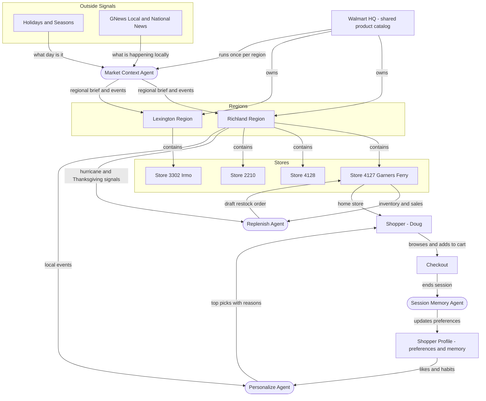

# Spark Agent — Demo Hierarchy

Paste the code below into Lucidchart (Insert → Diagram as code → Mermaid). Rounded boxes are agents.

**How to read it:** news and the calendar feed one Market Context run per region. Every store and shopper in that region shares the result. Replenish uses it to restock the store, and Personalize combines it with the shopper's profile to recommend products. After checkout, Session Memory updates the profile, so the next visit's picks are better.
